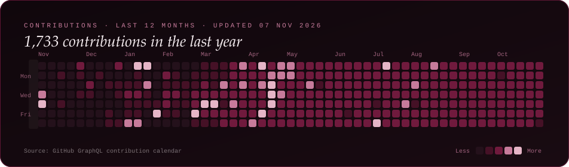
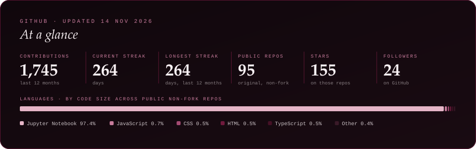

  <picture>
    <source media="(prefers-reduced-motion: reduce)" srcset="https://raw.githubusercontent.com/itsluckysharma01/itsluckysharma01/main/assets/lucky-hero-static.svg">
    
  </picture>

 

### 01 · About

I'm a research scholar at **IIT Ropar** (AI & Data Engineering), working on **domain adaptation and transfer learning**: how to keep a model useful when the data it meets in deployment doesn't look like the data it was trained on. Most of my current work is unsupervised and partial domain adaptation, built on prototypical contrastive learning and optimal transport, across plant-disease imagery and remote-sensing data.

Before the PhD I spent my time on applied ML. At C-DAC Mohali I built a reinforcement-learning SSH honeypot and fine-tuned a small language model for command generation; outside of that I shipped a few vision projects, which you'll find below.

### 02 · Path so far

| When | What | Where |
| :-- | :-- | :-- |
| Jul 2026 – now | PhD Research Scholar, AI & Data Engineering | Indian Institute of Technology Ropar |
| Jan – Jul 2026 | AI/ML Intern (Work-Based Learning) | C-DAC Mohali, Govt. of India |
| Aug 2025 – Jan 2026 | Google Campus Ambassador | Govt. College Dharamshala |
| Jun – Jul 2025 | Hands-on Training, Data Curation & Python | NIELIT Chandigarh (MeitY), Ropar |
| Aug 2022 – Jun 2026 | B.Tech, Computer Science & Engineering · CGPA 8.01/10 | Government College Dharamshala |

### 03 · Achievements & certifications

**Publication.** *A Comprehensive Analysis of Deep Learning-Based Algorithms for Detection of Skin Diseases.* IJEECE, Research Trend (ISSN 2277-2626), April 2025. [Read the paper ↗](https://drive.google.com/file/d/1bwJhXnyhBQgnhOPy2YTKAiN3Gyd-bRO7/view?usp=sharing)

- **Semi-finalist**, Convolve 4.0 — Pan-IIT AI/ML Hackathon, IIT Guwahati (2025)
- **Participant**, Changethon — National Social Summit, IIT Roorkee (2026)
- **Google Campus Ambassador**: ran ML and generative-AI workshops and a live Gemini API demo for 400+ students

| Certification | Issuer | Date |
| :-- | :-- | :-- |
| Oracle Cloud Infrastructure 2025 Data Science Professional | Oracle University | Sep 2025 |
| AI–Machine Learning Engineer Foundation Course | Reliance Foundation & Skill India | Nov 2025 |
| Mastering Machine Learning & Data Science: From Beginner to Expert | GeeksforGeeks | Mar 2026 |
| Data Analysis: Python and Excel | GeeksforGeeks | Jun 2026 |

### 04 · Selected projects

#### [AI Clinical Skin Disease Detection](https://github.com/itsluckysharma01/Skin_Diseases_Detection_Using_Deep-Learning_30_Classes)
`EfficientNet` `Python` `Flask` `Docker` `Hugging Face Spaces`

A 30-class skin-condition classifier trained on 6.4K images. It reaches 91% training and 75% validation accuracy, and runs as a browser-based app on Hugging Face Spaces, so nobody has to install anything to try it.

[Repository](https://github.com/itsluckysharma01/Skin_Diseases_Detection_Using_Deep-Learning_30_Classes) · [Live demo ↗](https://huggingface.co/spaces/itsluckysharma01/Skin_Diseases_Detection_of_30_Classes)

#### [NETRA — Smart Video Surveillance](https://github.com/itsluckysharma01/NETRA-Network-for-Enhanced-Threat-Recognition-Action-)
`YOLOv8` `OpenCV` `Flask` `Python`

Network for Enhanced Threat Recognition & Action. YOLOv8-based video analysis that flags threats in real time (98% detection accuracy) and triggers response actions automatically instead of waiting on someone watching the feed.

[Repository](https://github.com/itsluckysharma01/NETRA-Network-for-Enhanced-Threat-Recognition-Action-) · [Live demo ↗](https://huggingface.co/spaces/itsluckysharma01/NETRA-A_Video_Surveillance_Web_Application)

#### [Museum Heist — Pursuit-Evasion under Partial Observability](https://github.com/itsluckysharma01/The-Museum-Heist-Pursuit-Evasion-Simulation_-Cat-and-Mouse-_POMDP-CDAC)
`POMDP` `BFS` `Pygame` `Python`

A cat-and-mouse simulation on a 10×10 grid. The guard tracks a hidden intruder with a noisy POMDP belief state and live heatmaps; the intruder switches between four behaviour modes depending on how close the threat is.

[Repository](https://github.com/itsluckysharma01/The-Museum-Heist-Pursuit-Evasion-Simulation_-Cat-and-Mouse-_POMDP-CDAC)

### 05 · Toolkit

| | |
| :-- | :-- |
| **Research** | Domain adaptation · Transfer learning · Computer vision · Reinforcement learning |
| **Languages** | Python · C++ · Java · SQL · JavaScript |
| **Deep learning** | PyTorch · TensorFlow · scikit-learn · Transformers · OpenCV |
| **Language models** | LLM fine-tuning · RAG · NLP · Hugging Face |
| **Data** | NumPy · Pandas · Streamlit · Power BI |
| **Shipping** | Flask · FastAPI · Docker · Git · CI/CD · MLOps · Render |

### 06 · Contributions

  

Same year, animated

 

  <picture>
    <source media="(prefers-color-scheme: dark)" srcset="https://raw.githubusercontent.com/itsluckysharma01/itsluckysharma01/output/github-contribution-grid-snake-dark.svg">
    <source media="(prefers-color-scheme: light)" srcset="https://raw.githubusercontent.com/itsluckysharma01/itsluckysharma01/output/github-contribution-grid-snake.svg">
    
  </picture>

### 07 · GitHub at a glance

  

Both cards are generated by this repo's own <a href=".github/workflows/snake.yml">workflow</a> from the GitHub GraphQL API and refreshed daily. Public activity only.

### 08 · Find me

  
  
  
  
  

Open to research collaborations in domain adaptation, transfer learning and robust computer vision.

 

  

